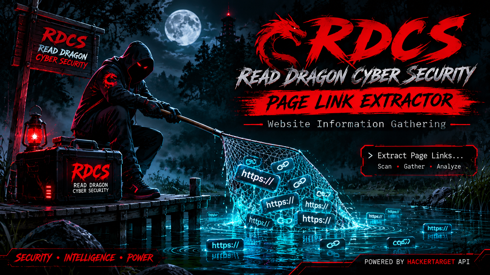

# WEB-LINK

  

### READ DRAGON CYBER SECURITY
🔴 RDCS — READ DRAGON CYBER SECURITY

  <b>PAGE LINK EXTRACTOR</b> 
  Lightweight Website Information Gathering Tool

  

  ![Platform](

✨ Features

- 🔗 Page Link Extractor
- 🌐 Website URL Input
- ⚡ HackerTarget API Integration
- 📱 Termux Support
- 🐧 Linux Support
- 🎨 Custom RDCS Terminal Interface
- 🔙 Back & Exit Navigation
- 📢 RDCS Facebook Page Shortcut

📦 Requirements

- Bash
- cURL
- Internet Connection
- Termux or Linux

🚀 Installation

Step 1: Clone Repository

git clone https://github.com/YOUR-USERNAME/RDCS-Page-Link-Extractor.git

Step 2: Enter Directory

cd RDCS-Page-Link-Extractor

Step 3: Install Requirements

pkg update && pkg install curl -y

Step 4: Give Execution Permission

chmod +x rdcs.sh

Step 5: Run RDCS

./rdcs.sh

🖥️ Usage

1. Launch RDCS.
2. Select "01 - Page Link Extractor".
3. Enter a website domain.
4. View the returned page links.

🔌 API

RDCS uses the HackerTarget Page Links API:

https://api.hackertarget.com/pagelinks/

API availability and usage limits are controlled by the API provider.

⚠️ Disclaimer

This tool is intended for educational purposes and authorized website information gathering only.

- Only use it on websites you own or have permission to assess.
- Respect website terms of service and applicable laws.
- RDCS is not responsible for misuse of this tool.
- Third-party API availability is not guaranteed.

👨‍💻 Developer

READ DRAGON CYBER SECURITY (RDCS)

Facebook Page:
https://www.facebook.com/RDCSSOCIETY

⭐ Support

If you find this project useful, consider giving the repository a ⭐ Star on GitHub.

---

  <b>RDCS — READ DRAGON CYBER SECURITY</b> 
  <i>Knowledge • Security • Responsibility</i>

